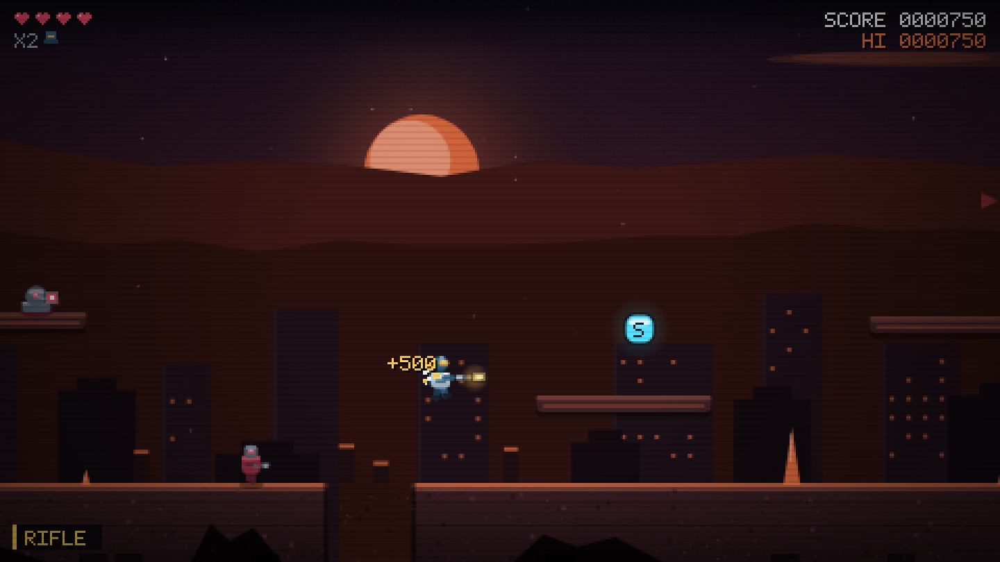
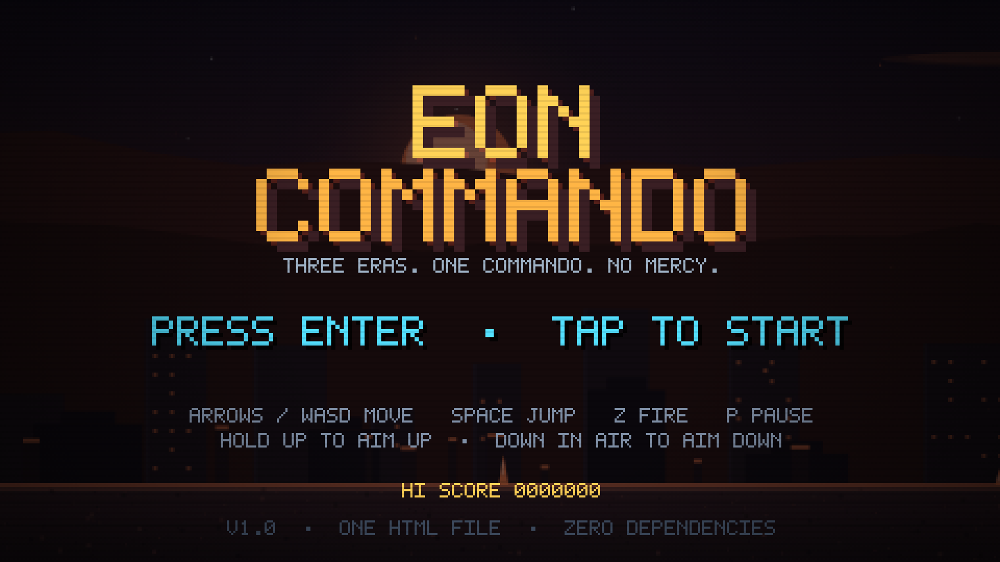
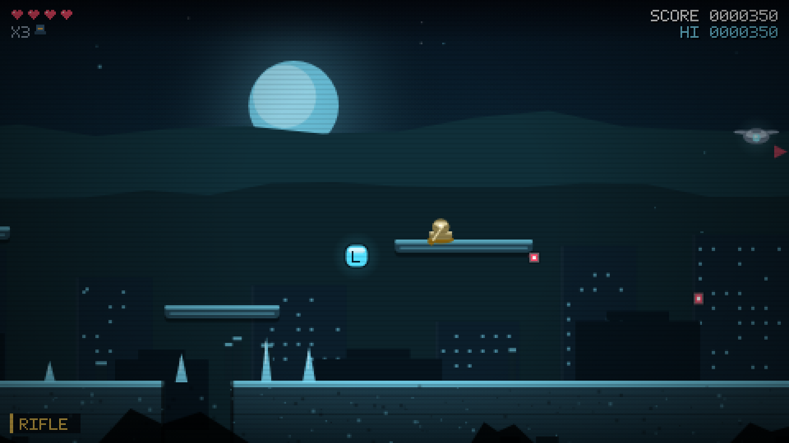
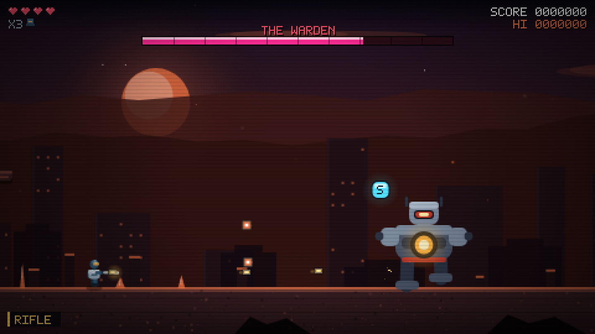
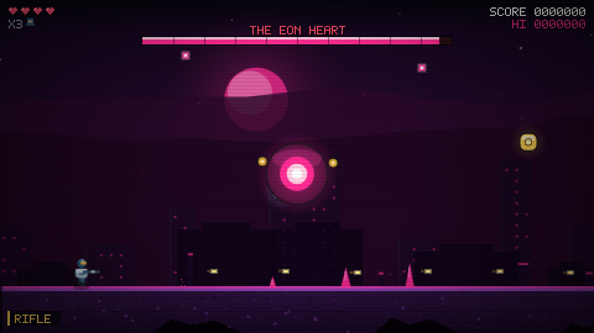
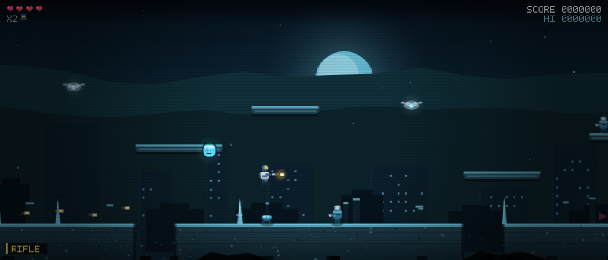

<div align="center">

# EON COMMANDO

<!-- shot:start -->



<!-- shot:end -->

**A retro run-and-gun platformer — one self-contained HTML file. No install, works offline, PolyForm Noncommercial licensed.**

[](https://github.com/drsamonline/eon-commando/stargazers)
[](https://github.com/drsamonline/eon-commando/network/members)
[](LICENSE)
[](https://github.com/drsamonline/eon-commando/commits/main)

### ▶&nbsp; <a href="https://drsamonline.github.io/eon-commando/play/"><b>PLAY NOW</b></a> &nbsp;·&nbsp; <a href="https://drsamonline.github.io/eon-commando/">Landing page</a> &nbsp;·&nbsp; <a href="https://drsamonline.github.io/">All projects</a>

</div>

---

<div align="center">

<br>

[](https://drsamonline.github.io/eon-commando/play/)
[](https://drsamonline.github.io/eon-commando/play/)

<sub>Runs in the browser · nothing to install · works offline once loaded</sub>

<br>

[](https://drsamonline.github.io/eon-commando/)
[](CHANGELOG.md)
[](#-zero-dependencies)
[](#-zero-dependencies)

[](#-quick-start)
[](#-quick-start)
[](#-quick-start)
[](#-how-it-works)
[](#-contributing)

</div>

---

## ▶ Play it

<table>
<tr>
<td width="50%" valign="top">

### 🌐 Play online

**[drsamonline.github.io/eon-commando/play/](https://drsamonline.github.io/eon-commando/play/)**

Nothing to install. Opens in any modern browser — desktop or phone. Once loaded it runs entirely offline.

</td>
<td width="50%" valign="top">

### 💾 Run it locally

**[Download `index.html`](https://github.com/drsamonline/eon-commando/raw/main/index.html)** — or clone the repo:

```bash
git clone https://github.com/drsamonline/eon-commando.git
cd eon-commando
open index.html    # macOS
                   # xdg-open on Linux, start on Windows
```

</td>
</tr>
</table>

**No install. No build. No server. One file.** Open `index.html` in any modern browser — double-click it, or drag it into a tab. That is the whole setup.

Works identically from `file://` and from a web server. Works offline. Works on a phone.

| | |
| :-- | :-- |
| **Source** | [github.com/drsamonline/eon-commando](https://github.com/drsamonline/eon-commando) |
| **Download** | [index.html](https://github.com/drsamonline/eon-commando/raw/main/index.html) (109 KB, self-contained) |
| **Landing page** | [drsamonline.github.io/eon-commando](https://drsamonline.github.io/eon-commando/) |

---

## 📸 Screenshots

<div align="center">

**Title** — three eras, one commando



<br><br>

**Era I · Ashen Dawn** — the burning city, turrets on the rooftops


<br><br>

**Era II · Glacier Eon** — ice shelves over open air



<br><br>

**Boss — The Warden** — spread fire, shoulder cannons, ground shockwave



<br><br>

**Boss — The Eon Heart** — a spiral that closes from every angle



<br><br>

**Widescreen** — the view widens from 16:9 to 21:9 instead of letterboxing



</div>

---

## 🆕 What's new in 1.1

- **Curved, hand-drawn sprites.** Every character was rebuilt from stacked rectangles into
  rounded caps, arcs, ellipses and bezier limbs — helmets, visors, shoulders, knees and
  boots all have real silhouettes now, while the game stays pixel-pure on the 480×270 grid.
- **Enemy variation.** One rig, many looks: each era reskins the same enemy silhouette
  (ember → frost → core), spawns get ±6% scale jitter, and roughly one in eight is an
  **elite** in gold with ~1.8× health.
- **Widescreen.** The logical viewport follows your window's aspect ratio from 16:9 up to
  21:9, so ultrawide and 16:10 screens fill properly instead of letterboxing. Boss arenas
  keep a fixed 16:9 footprint and the camera centres them, so a wide screen sees the walls
  rather than the void.
- **Readability pass.** Enemy bullets got dark rims, glow and motion trails; screen-edge
  arrows point at enemies you cannot see; the background dims 18% during boss fights.
- **Better feel.** Corner correction — you now slide around a ledge instead of bonking your
  head on it — plus rounded platforms and ground edges that no longer read as knife cuts.

---

## Contents

- [Play it](#-play-it) — **[live demo](https://drsamonline.github.io/eon-commando/play/)**
- [Screenshots](#-screenshots)
- [Why it is interesting](#-why-it-is-interesting)
- [Controls](#-controls)
- [The three eras](#-the-three-eras)
- [Weapons](#-weapons)
- [Enemies and bosses](#-enemies-and-bosses)
- [How it works](#-how-it-works)
- [Project layout](#-project-layout)
- [Build and test](#-build-and-test)
- [Roadmap](#-roadmap)
- [License](#-license)

---

## ✨ Why it is interesting

- **One file, no network.** `index.html` is the game. No CDN, no fetch, no `localStorage` requirement — high scores simply save if storage is available.
- **No assets at all.** Every sprite is drawn from rectangles and paths at runtime. Every sound is synthesised from oscillators and noise buffers. The HUD font is a 5×7 bitmap defined as strings.
- **Manual fire, classic rules.** No auto-aim, no regenerating health. Four hearts, three lives, and you lose your weapon when you die — back to the rifle.
- **Coyote time and jump buffering.** Six frames of coyote time, seven of buffered input, variable jump height. It feels like a 16-bit game, not a web demo.
- **Three stages, three bosses, two phases each.** Half health changes the fight: wider spreads, summoned drones, faster spirals.
- **Fixed 60 Hz simulation.** An accumulator drives physics, so a 144 Hz monitor does not make the commando run faster.
- **Touch and keyboard, same code.** On-screen pads appear only on touch devices; gamepads work through the Gamepad API.

---

## 🎮 Controls

| Action | Keyboard | Touch | Gamepad |
| :-- | :-- | :-- | :-- |
| Move | `←` `→` / `A` `D` | Left D-pad | D-pad / left stick |
| Aim up | `↑` / `W` | D-pad up | D-pad up |
| Aim down (mid-air) | `↓` / `S` | D-pad down | D-pad down |
| Duck | `↓` while standing | D-pad down | D-pad down |
| Jump | `Space` `X` `K` | **A** | A / cross |
| Fire | `Z` `J` `Ctrl` | **B** | X / square |
| Pause | `P` `Esc` | ❙❙ | Start |
| Mute | `M` | — | — |

Hold jump for the full arc, tap it for a short hop. Aiming is eight-directional: hold a direction while firing.

---

## 🕰 The three eras

| # | Era | Setting | Boss |
| :-: | :-- | :-- | :-- |
| I | **ASHEN DAWN** | The burning city at dusk — long sightlines, chasms, rooftop turrets | **THE WARDEN** |
| II | **GLACIER EON** | The frozen vault — narrow ledges, more air than ground, drone swarms | **GLACIER WRAITH** |
| III | **EON CORE** | The heart of time — tight platforms, dense fire | **THE EON HEART** |

Each stage is hand-laid: ground segments with real chasms, one-way platforms, checkpointed respawns, and an arena at the end where the camera locks and the gate shuts behind you.

---

## 🔫 Weapons

| Weapon | Cadence | Damage | Behaviour |
| :-- | :-- | :-- | :-- |
| **RIFLE** | medium | 1 | Default. Always with you, always reliable. |
| **SPREAD** | slow | 1 ×3 | Three pellets in a fan. |
| **MACHINE** | very fast | 1 | Jittery, forgiving, melts anything static. |
| **LASER** | slow | 3 | Punches through three targets. |
| **FLAME** | fastest | 1 | Short reach, wide cloud, burns through crowds. |

Pickups float in capsules: **weapons**, **repair** (2 hearts) and **Eon shards** (+500). A fatal hit drops you back to the rifle — the classic run-and-gun tax.

---

## 👾 Enemies and bosses

| Enemy | Behaviour |
| :-- | :-- |
| **Grunt** | Patrols, stops to shoot, reverses at ledges |
| **Runner** | Charges when it sees you, leaps the gaps |
| **Drone** | Hovers on a sine wave, drifts over your head, drops bombs |
| **Turret** | Fixed, tracks you, fires aimed shots |
| **Jumper** | Hops toward you, shoots mid-leap |

| Boss | Phase 1 | Phase 2 (below half health) |
| :-- | :-- | :-- |
| **The Warden** | Walks the arena, 3-way spread, ground shockwave | 5-way spread, faster cadence, quicker stomps |
| **Glacier Wraith** | Flies, aimed bursts, fan of ice shards | Calls in drones, wider shard fan |
| **The Eon Heart** | Four-armed spiral, aimed volley | Six-armed spiral, faster, summons runners |

---

## ⚙ How it works

| System | Implementation |
| :-- | :-- |
| **Loop** | Fixed 1/60 s step with an accumulator; render once per animation frame |
| **Rendering** | One 480×270 canvas, integer-scaled with `image-rendering: pixelated` |
| **Art** | Rectangles and paths — the commando, enemies, bosses, skylines, props |
| **Text** | A 5×7 bitmap font defined as `#`/`.` strings, drawn pixel by pixel |
| **Audio** | Web Audio: square/saw/triangle oscillators, noise buffers, a look-ahead sequencer |
| **Music** | Per-era tracks — bass, lead and noise drums — scheduled against the audio clock |
| **Input** | One action set merged from keyboard, pointer pads and the Gamepad API |
| **Camera** | Lerped horizontal follow, clamped to the stage, locked during boss fights |
| **Save** | `localStorage` for high score and mute, wrapped so private mode never throws |

### Zero dependencies

There is no `package.json` to install, no bundler, no framework, and no asset pipeline. The shipped `index.html` makes **no network requests of any kind** — not for fonts, not for images, not for analytics. Load it once, unplug the network, keep playing.

---

## 🗂 Project layout

```
eon-commando/
├── index.html            ← the game (built, self-contained, ~100 KB)
├── build.py              ← src/ → index.html
├── src/
│   ├── 00_head.html      ← document, CSS, touch pad markup
│   ├── 10_core.js        ← constants, maths, storage, URL params
│   ├── 20_audio.js       ← chiptune synth + the era tracks
│   ├── 30_input.js       ← keyboard / touch / gamepad, canvas scaling
│   ├── 40_art.js         ← 5×7 font, the commando, enemies, bosses
│   ├── 50_content.js     ← weapons, enemy stats, the three stages
│   ├── 60_entities.js    ← physics, AI, bullets, particles, boss patterns
│   ├── 70_game.js        ← state machine, stage flow, camera, scoring
│   ├── 80_render.js      ← parallax eras, world, HUD, screens
│   ├── 90_main.js        ← canvas setup, fixed-step loop, demo harness
│   └── 99_tail.html
└── docs/                 ← GitHub Pages root
    ├── index.html        ← landing page
    ├── play/index.html   ← the game, served live
    └── shots/*.png       ← screenshots
```

---

## 🛠 Build and test

The build is a concatenation — no toolchain, no dependencies, Python 3 only:

```bash
python3 build.py        # src/ -> index.html
```

That is the entire build. To check a change without opening a browser, the game exposes a deterministic demo harness through URL parameters:

```bash
# 400 simulated frames of era I, then freeze the frame
index.html?shot=1&stage=1&demo=400

# drop straight into a boss fight
index.html?shot=1&stage=3&warp=2520&demo=320&right=0
```

`?demo=N` runs N fixed steps with scripted input, `?warp=X` teleports the commando, `?shot=1` strips the page chrome for screenshots, and `?debug=1` writes the game state into the document title. Every screenshot in this README was captured with those flags in headless Chromium.

---

## 🗺 Roadmap

- [x] Three eras with distinct palettes, hazards and parallax
- [x] Five weapons with distinct cadence, spread and piercing
- [x] Three bosses with two phases each
- [x] Chiptune music and sound effects, synthesised at runtime
- [x] Keyboard, touch pads and gamepad
- [x] High-score persistence, pause, mute
- [x] Curved sprite art with per-era palettes, scale jitter and elite variants
- [x] Widescreen viewport (16:9 → 21:9) with a fixed-footprint boss arena
- [x] Readability pass: bullet rims and trails, off-screen threat arrows, background dimming
- [ ] Difficulty select (Recruit / Commando / Eon)
- [ ] Two-player local co-op on one keyboard, then LAN play on [`lan-kit`](https://github.com/drsamonline/lan-kit)
- [ ] Endless mode with escalating waves
- [ ] Optional CRT shader toggle

---

## 🤝 Contributing

Issues and pull requests are welcome. The source is deliberately plain: no framework, no transpiler, no minifier. Edit a file under `src/`, run `python3 build.py`, reload `index.html`. If you add a stage, add it to `STAGES` in `src/50_content.js` and it will appear in the campaign.

---

## 📜 License

[PolyForm Noncommercial License 1.0.0](LICENSE) — free to use, modify and share for any noncommercial purpose. Commercial use requires a separate licence.

Game design, code and art: **Dr Sohil Momin**. Everything in this repository is original work; no third-party assets are used, because there are no assets.

<div align="center">
<br>
<sub>Built with vanilla JavaScript, one canvas, and a lot of rectangles.</sub>
</div>
